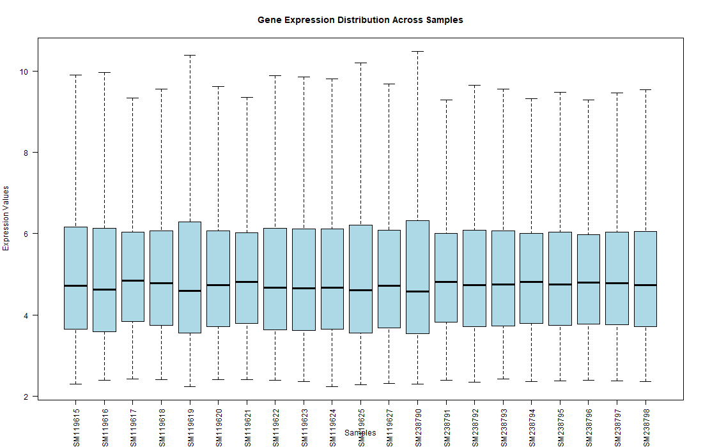
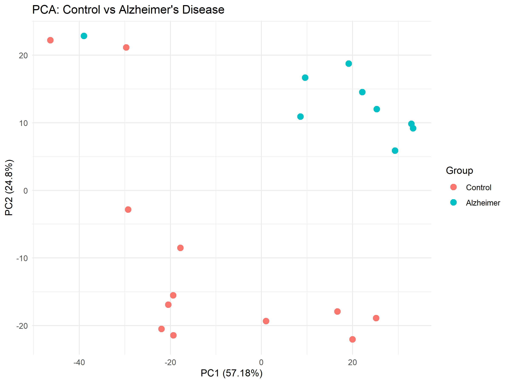
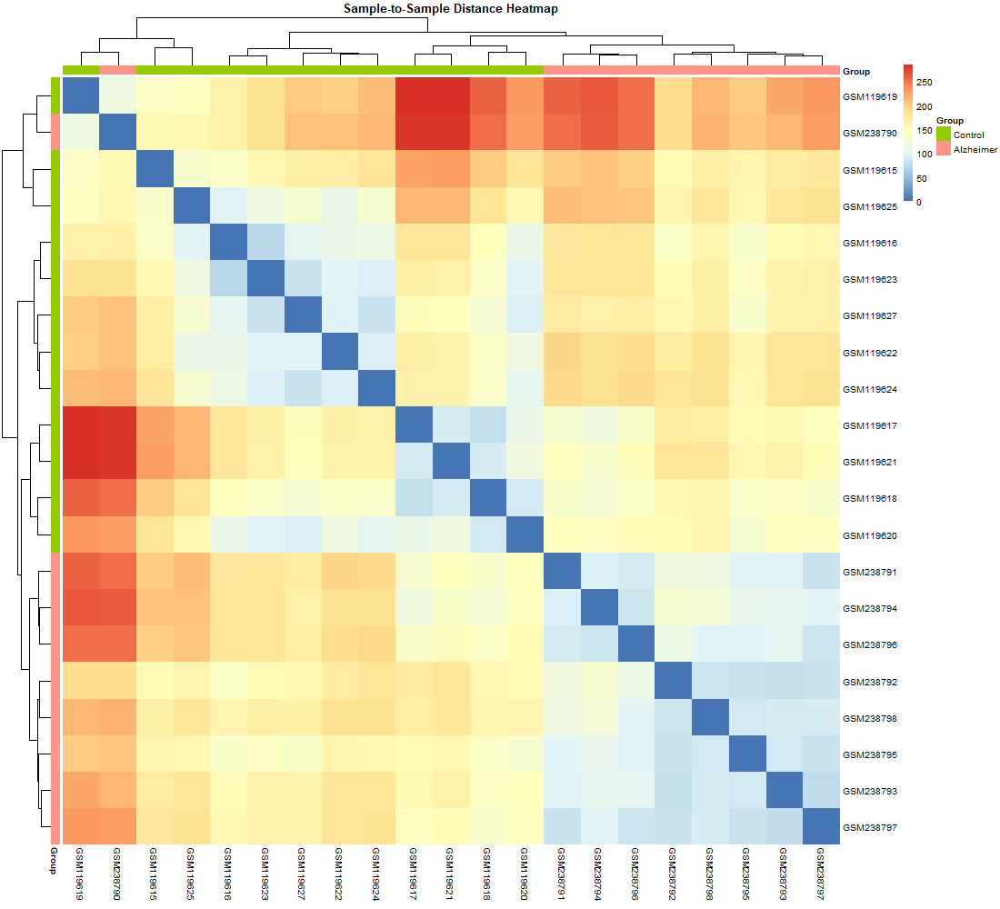
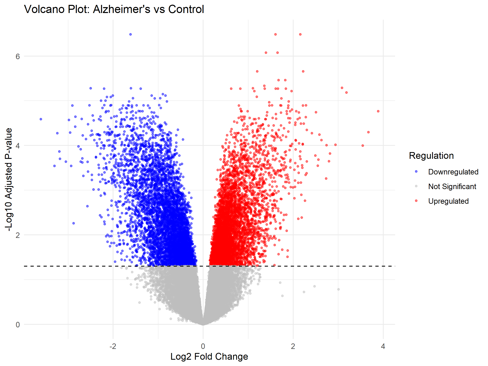
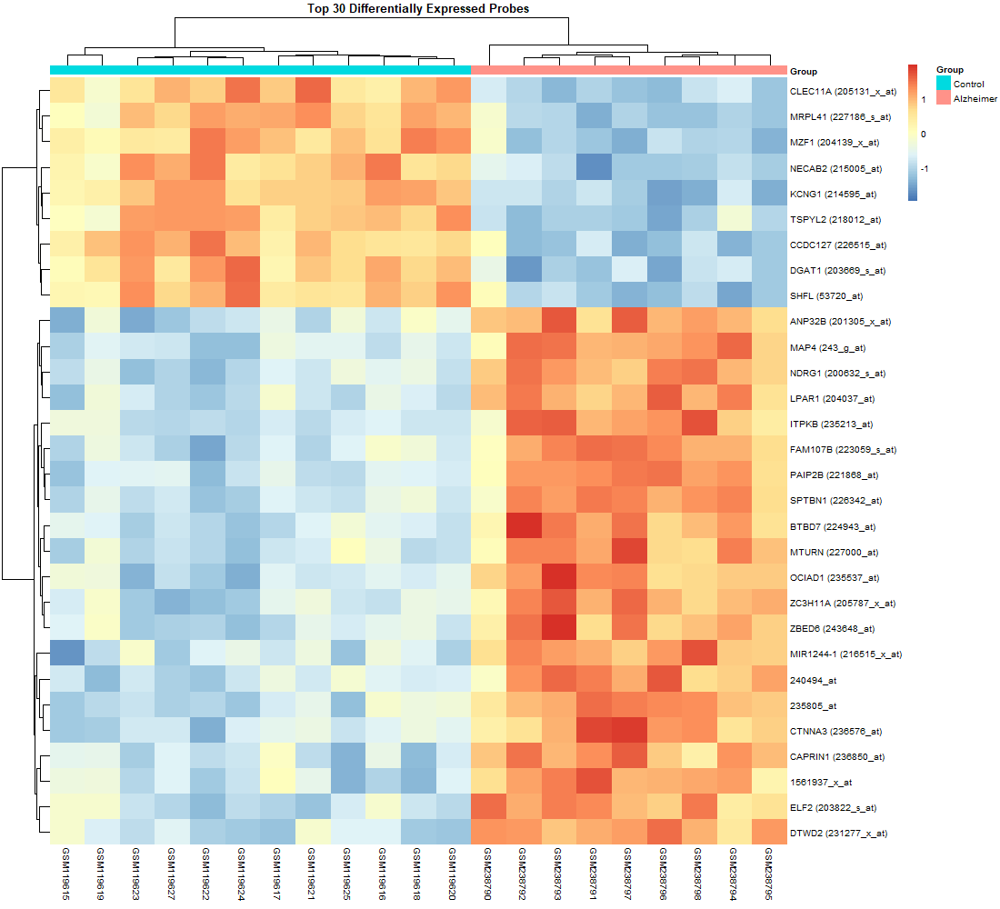

# Gene Expression Analysis in Alzheimer's Disease Using Entorhinal Cortex Data

## 1. Abstract

Alzheimer's disease affects memory and thinking. This project studies whether gene expression is different in brain samples from people with Alzheimer's disease and people without the disease. I used the public `GSE5281_EC` dataset, which contains 21 samples from the entorhinal cortex: 12 control samples and 9 Alzheimer's disease samples. The dataset has 54,675 microarray probes. I analyzed the data in R using quality checks, Principal Component Analysis (PCA), heatmaps, and the `limma` package. After adjusting the p-values for multiple testing, I found 11,624 significant probes. Of these, 5,991 had higher expression and 5,633 had lower expression in the Alzheimer's group. These results show differences between the groups in this dataset. They do not prove that these genes cause Alzheimer's disease.

## 2. Introduction and Research Objectives

### 2.1 Background

Alzheimer's disease is a brain disease that slowly affects memory, thinking, and daily activities. Scientists are still studying the changes that happen in the brain during this disease. One way to study these changes is to compare **gene expression** in healthy and affected brain tissue.

Gene expression describes how actively a gene is being used to produce RNA. Changes in gene expression may help researchers understand what is happening in cells. However, an expression difference does not automatically mean that a gene causes a disease.

This project focuses on the **entorhinal cortex**, a part of the brain involved in memory. This area is often affected by Alzheimer's disease. Studying samples from this area may help us identify expression patterns linked to the disease.

I used **microarray data**. A microarray measures the expression of thousands of probes at the same time. A probe is a measurement feature on the microarray. Some genes have more than one probe, so the number of probes is not the same as the number of unique genes.

Public datasets allow students to carry out bioinformatics research without collecting new samples. I selected the `GSE5281_EC` dataset because it provides two groups that can be compared using R.

### 2.2 Research Question

**Which microarray probes show significant differences in expression between Alzheimer's disease and control samples from the entorhinal cortex?**

### 2.3 Aim

The aim of this project is to find and visualize gene expression differences between Alzheimer's disease and control samples using R.

### 2.4 Objectives

1. Load the public dataset and check the number of samples and probes.
2. Check the expression data for missing or infinite values.
3. Explore sample patterns using a boxplot, PCA plot, and sample-distance heatmap.
4. Use `limma` to identify probes with significant expression differences.
5. Add gene symbols and names where they are available.
6. Present the results using a volcano plot and a heatmap of the top 30 significant probes.

## 3. Dataset Description

### 3.1 Dataset Source

The dataset is called **`GSE5281_EC`**. It is available in the Bioconductor package `KEGGdzPathwaysGEO` and is linked to the public NCBI Gene Expression Omnibus (GEO) study **GSE5281**. The samples come from the human entorhinal cortex.

| Item | Details |
|---|---|
| Dataset | `GSE5281_EC` |
| Public study | GEO accession `GSE5281` |
| Brain area | Entorhinal cortex |
| Technology | Microarray |
| Platform | Affymetrix Human Genome U133 Plus 2.0 (`hgu133plus2`) |
| Total samples | 21 |
| Control samples | 12 |
| Alzheimer's disease samples | 9 |
| Total probes | 54,675 |
| R data format | `ExpressionSet` |

Each row of the expression matrix represents a probe, and each column represents a sample. The sample information identifies the two groups. In the dataset, `c` means Control and `d` means Alzheimer.

The data are loaded directly in R:

```r
library(KEGGdzPathwaysGEO)
data("GSE5281_EC", package = "KEGGdzPathwaysGEO")
```

There is no need to download a separate CSV file to run this project.

### 3.2 Data Quality

Before the main analysis, I checked the number of probes and samples, the sample groups, and whether the expression matrix contained missing or infinite values.

The results were:

- **54,675 probes** and **21 samples**.
- **12 controls** and **9 Alzheimer's disease samples**.
- **0 missing values**.
- **0 infinite values**.
- Expression values ranged from about **2.23 to 14.25**.

I also created a boxplot to compare expression distributions across samples.



*Figure 1: Expression values across the 21 samples.*

I used the **processed expression data already provided in the package**. My code does not carry out raw microarray normalization or batch correction. The original study should be checked for details about how these values were prepared.

### 3.3 Ethical Considerations

This project uses existing public data. I did not collect samples or contact any patients. The analysis compares groups and does not try to identify individual people. The original dataset should be credited when sharing the results.

## 4. Methodology

### 4.1 Software and Packages

I used **R 4.6.2** and RStudio. The following packages were used:

| Package | Why it was used |
|---|---|
| `KEGGdzPathwaysGEO` | Load the dataset |
| `Biobase` | Read expression values and sample information |
| `ggplot2` | Make PCA and volcano plots |
| `pheatmap` | Make heatmaps |
| `limma` | Compare expression between the two groups |
| `AnnotationDbi` | Connect probe IDs to gene information |
| `hgu133plus2.db` | Find gene symbols and names for this microarray |

### 4.2 Data Loading and Checking

First, I loaded the dataset and extracted its expression matrix. Then I created the Control and Alzheimer groups from the sample labels. I checked the data size, missing values, and infinite values. I created an expression boxplot to see how the measurements were distributed across samples.

These checks helped me understand the dataset before using statistical methods. They do not prove that there are no other data-quality problems.

### 4.3 Principal Component Analysis (PCA)

PCA is a method that reduces a large dataset into a few main components. It helps us see patterns between samples.

For this project, I calculated the variance of every probe and selected the **500 probes with the highest variance**. I then used the R function `prcomp()` to calculate PCA. The first two components were shown in a scatter plot, with different colors for the two sample groups.



*Figure 2: PCA of the 500 most variable probes.*

This plot helps show whether samples from the two groups have similar or different expression patterns. PCA is an exploratory method, not a test that proves a sample has Alzheimer's disease.

### 4.4 Sample-Distance Heatmap

Next, I calculated **Euclidean distances** between samples using the expression values from all 54,675 probes. A smaller distance means that two samples have more similar overall expression values.

I displayed these distances in a heatmap and added labels for the Control and Alzheimer groups.



*Figure 3: Distances between samples using the full expression matrix.*

This heatmap helps compare samples and identify groups of samples with similar expression patterns. Unlike PCA, this step uses all probes instead of only the top 500 variable probes.

### 4.5 Differential Expression Analysis

I used the **`limma`** package to find probes that have different expression levels in the Alzheimer and Control groups. `limma` fits a statistical model to the expression values of each probe.

The comparison was defined as:

**Alzheimer − Control**

This means:

- A **positive `logFC`** indicates higher expression in the Alzheimer group.
- A **negative `logFC`** indicates lower expression in the Alzheimer group.

I used `eBayes()` to improve the statistical estimates. Because thousands of probes were tested, I used the **Benjamini–Hochberg (BH)** method to adjust the p-values. A probe was considered significant when its **adjusted p-value was below 0.05**.

I did not apply an extra minimum fold-change cutoff. A significant result shows a statistical difference, but it does not always mean the difference is large or medically important.

### 4.6 Gene Annotation

The results first contained probe IDs, such as `200632_s_at`. I used `AnnotationDbi` and `hgu133plus2.db` to add gene symbols and full gene names where possible.

Some probes did not have a gene symbol. Some probes could also match more than one gene annotation. My code uses the first available match when this happens. For these reasons, I report the number of **significant probes**, not the number of unique genes.

### 4.7 Results Visualization

I created two more plots after the statistical analysis. The **volcano plot** shows the size and statistical significance of expression differences for all tested probes. The **Top-30 Heatmap** shows expression patterns for the 30 most statistically significant probes. In this heatmap, each row is standardized so it is easier to compare a probe's pattern across samples.

## 5. Results

### 5.1 Main Results

The analysis tested **54,675 probes**. It found **11,624 significant probes** using the BH-adjusted p-value threshold of 0.05.

| Result | Number of probes |
|---|---:|
| Total tested | 54,675 |
| Significant | 11,624 |
| Higher expression in Alzheimer group | 5,991 |
| Lower expression in Alzheimer group | 5,633 |

The number of significant probes suggests that there are many expression differences between the two groups in this dataset. It does not mean that 11,624 different genes cause Alzheimer's disease.

### 5.2 Examples of Significant Probes

The following examples are taken from my R console output. Values are rounded.

| Probe ID | Gene symbol | logFC | Adjusted p-value |
|---|---|---:|---:|
| `200632_s_at` | NDRG1 | 1.606 | 3.26 × 10⁻⁷ |
| `214595_at` | KCNG1 | -1.614 | 3.26 × 10⁻⁷ |
| `204037_at` | LPAR1 | 2.159 | 3.26 × 10⁻⁷ |
| `221868_at` | PAIP2B | 1.654 | 8.40 × 10⁻⁷ |
| `243_g_at` | MAP4 | 1.203 | 2.21 × 10⁻⁶ |
| `226342_at` | SPTBN1 | 2.221 | 2.21 × 10⁻⁶ |

For example, NDRG1 had a positive `logFC`, so its measured expression was higher in the Alzheimer group. KCNG1 had a negative `logFC`, so its measured expression was lower. These results describe differences in this dataset; they are not proof that these genes cause the disease.

One highly ranked probe, `235805_at`, did not have a gene symbol in the annotation output. This shows why gene annotation should be checked carefully.

### 5.3 Volcano Plot



*Figure 4: Volcano plot of differential expression results.*

The x-axis shows `logFC`, and the y-axis shows `-log10` of the adjusted p-value. Red points represent significant probes with higher expression in the Alzheimer group. Blue points represent significant probes with lower expression. Grey points represent probes that were not classified as significant.

The dashed horizontal line shows the adjusted p-value threshold of 0.05. The plot makes it easier to see how many probes have significant changes and the direction of those changes.

### 5.4 Top-30 Heatmap



*Figure 5: Expression patterns of the 30 most statistically significant probes.*

This heatmap shows the expression pattern of each selected probe across all samples. The values are standardized separately for each row. This helps compare patterns, but the colors do not show the original expression values.

The heatmap is useful for exploring whether the selected probes show different patterns in Control and Alzheimer samples. It should not be used alone to claim that the groups can always be separated perfectly.

## 6. Discussion and Limitations

The main finding is that many probes have different expression levels in Alzheimer's disease samples compared with controls. The `limma` analysis found 11,624 significant probes. This suggests that the two groups have important differences in their measured RNA expression.

The plots help explain the results from different angles. The boxplot shows the overall expression distributions. PCA and the sample-distance heatmap help explore how the samples are related. The volcano plot shows which probes have significant differences, while the Top-30 Heatmap focuses on a small group of highly ranked probes.

However, there are several limitations. First, the dataset contains only **21 samples**. A larger dataset could give more reliable results. Second, the project uses only the entorhinal cortex, so the findings may not be the same in other brain areas. Third, my statistical model compares the two groups without adding other factors such as age, sex, or possible batch differences. These factors may affect gene expression.

Another limitation is that microarray probes are not the same as unique genes. Several probes may represent one gene, and some probe annotations are missing or unclear. This means that the number of significant probes should not be described as the number of significant genes.

Finally, the data were collected in an earlier study. My project uses the processed values supplied by a Bioconductor package. I did not repeat the original raw-data processing or test the results in another dataset. The results show associations, not direct causes of Alzheimer's disease, and they are not a clinical diagnosis tool.

## 7. Conclusion and Future Work

This project used R to compare gene expression between Alzheimer's disease and control samples from the entorhinal cortex. I successfully loaded and checked the dataset, explored sample patterns, carried out differential expression analysis, added gene annotations, and created five figures.

Out of 54,675 probes, **11,624 were statistically significant**. Of these, 5,991 showed higher expression and 5,633 showed lower expression in the Alzheimer's disease group. The analysis demonstrates how public bioinformatics data and R tools can be used to study differences between biological groups.

In the future, I could compare these results with another Alzheimer's disease dataset, study which biological pathways are linked to the significant genes, and check whether sample characteristics affect the findings. These steps would help determine which results are more reliable and biologically meaningful.

## 8. Reproducibility

### 8.1 Project Files

```text
2021ICT66-BioInformatics/
├── README.md
├── code/
│   └── alzheimers_analysis.R
├── figures/
│   ├── 01_Expression_Boxplot.png
│   ├── 02_PCA_Plot.png
│   ├── 03_Sample_Distance_Heatmap.png
│   ├── 04_Volcano_Plot.png
│   └── 05_Top30_Heatmap.png
└── results/
    ├── All_Results.csv
    └── Significant_Probes.csv
```

### 8.2 How to Run the Project

I ran this project using **R 4.6.2** on Windows with RStudio. The required packages are `KEGGdzPathwaysGEO`, `Biobase`, `limma`, `AnnotationDbi`, `hgu133plus2.db`, `ggplot2`, and `pheatmap`.

Install the packages if they are not already installed:

```r
install.packages(c("BiocManager", "ggplot2", "pheatmap"))
BiocManager::install(c(
  "KEGGdzPathwaysGEO", "Biobase", "limma",
  "AnnotationDbi", "hgu133plus2.db"
))
```

Open the project folder in RStudio and make sure it is the working directory. Then run:

```r
source("code/alzheimers_analysis.R")
```

The script loads the dataset from the package, creates the `figures` and `results` folders if needed, and saves five PNG figures and two CSV files. It also checks whether all seven output files exist. My final console output showed `TRUE` for every expected file and displayed:

```text
All analysis outputs verified successfully.
```

This confirms that the files were generated during my run. It does not, by itself, prove that every scientific conclusion is correct. The project uses an `.R` script rather than an R Markdown notebook, so it does not produce an HTML or PDF notebook output.

## 9. References

1. NCBI Gene Expression Omnibus. **GSE5281 dataset**. https://www.ncbi.nlm.nih.gov/geo/query/acc.cgi?acc=GSE5281
2. Bioconductor. **KEGGdzPathwaysGEO package**. https://bioconductor.org/packages/KEGGdzPathwaysGEO/
3. Ritchie, M. E., et al. (2015). **limma powers differential expression analyses for RNA-sequencing and microarray studies**. *Nucleic Acids Research*, 43(7), e47. https://doi.org/10.1093/nar/gkv007
4. Benjamini, Y., & Hochberg, Y. (1995). **Controlling the false discovery rate: A practical and powerful approach to multiple testing**. *Journal of the Royal Statistical Society: Series B*, 57(1), 289–300. https://doi.org/10.1111/j.2517-6161.1995.tb02031.x
5. R Core Team. **R: A Language and Environment for Statistical Computing**. https://www.r-project.org/
6. Bioconductor. **Biobase, AnnotationDbi, and hgu133plus2.db documentation**. https://bioconductor.org/

**Note:** The original GEO study should be checked for details about raw-data preprocessing and dataset usage conditions. This report describes the processed data and the results produced by my R script.
